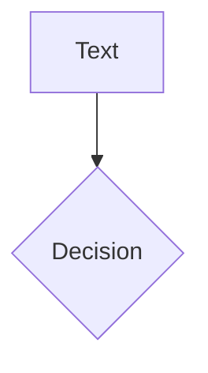
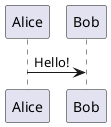

# Writing slides

Every built-in element and attribute starts with `slide-ng-` (`slide-ng-click`, `<slide-ng-clicks>`, `<slide-ng-toc />`); see [RENAMES.md](RENAMES.md) for the rule and the old names.

All slides live in one file, `slides.md`.

## Slides and frontmatter

A line with only `---` separates slides. A block of YAML between two `---`
lines at the top of a slide is that slide's frontmatter.

<!-- prettier-ignore -->
```md
---
title: My talk # headmatter: frontmatter of the first slide, describes the deck
---

# First slide

---
layout: center
class: text-red-500
---

# Second slide
```

Keys slide.ng understands:

| key                                                                    | what it does                                                                                                                   |
| ---------------------------------------------------------------------- | ------------------------------------------------------------------------------------------------------------------------------ |
| `layout`                                                               | one of the layouts below. The first slide is `cover` if you set nothing, all others `default`.                                 |
| `class`                                                                | extra CSS (UnoCSS) classes on the layout (on the content for layouts that have a `class` prop, see Layouts)                    |
| `title`                                                                | slide title (otherwise the first `#` heading); used in the browser tab, the table of contents and the goto box                 |
| `level`                                                                | depth in the table of contents (otherwise the number of `#` in the first heading)                                              |
| `hideInToc`                                                            | leave this slide out of `<slide-ng-toc>`                                                                                       |
| `routeAlias`                                                           | an extra address: `routeAlias: intro` makes `/intro` open this slide; `print`, `notes` and `presenter` are refused (app pages) |
| `hide`, `disabled`                                                     | the slide is left out of the deck completely                                                                                   |
| `clicksStart`                                                          | first click number of the slide (default 0)                                                                                    |
| `clicks`                                                               | fixes the number of clicks of the slide, whatever its elements ask for                                                         |
| `transition`                                                           | transition to the next slide, see Transitions                                                                                  |
| `src`                                                                  | take the slides from another markdown file, see Importing slides                                                               |
| `image`, `url`, `scale`, `backgroundSize`, `background`, `layoutClass` | props of some layouts                                                                                                          |

In the headmatter (the frontmatter of the first slide) you can also set:

| key                                                                              | what it does                                                                                          |
| -------------------------------------------------------------------------------- | ----------------------------------------------------------------------------------------------------- |
| `title`                                                                          | deck title (browser tab, info dialog)                                                                 |
| `info`                                                                           | markdown text shown in the info dialog                                                                |
| `colorSchema`                                                                    | `auto` (default: follow the system, the user can toggle), `light` or `dark` (fixed, no toggle)        |
| `transition`                                                                     | the transition of every slide that sets none                                                          |
| `defaults`                                                                       | frontmatter that every slide starts from, e.g. `defaults: { layout: center }`; a slide's own keys win |
| `theme`, `addons`                                                                | the look of the deck: a folder, a package name, or `default`; see "Themes and addons" below           |
| `titleTemplate`, `author`, `keywords`, `favicon`, `lang`, `htmlAttrs`, `seoMeta` | the page's `<head>`, see "The page, export and build" below                                           |
| `download`, `exportFilename`, `export`, `remoteAssets`, `pwa`                    | export and build settings, see below                                                                  |
| `codeCopy`, `magicMoveCopy`                                                      | `false` hides the copy button on every code block, or only on Magic Move blocks                       |
| `contextMenu`, `presenter`                                                       | `true` (default), `false`, `dev` or `build`: the right-click menu, and the presenter page and button  |
| `editor`                                                                         | `false` hides the side editor (dev server only)                                                       |

Other keys are kept in the slide's metadata and ignored, unless a theme or a component reads them.

## Importing slides

```md
---
src: ./pages/intro.md
class: from-here
---
```

The slide is replaced by the slides of that file. A range after `#` picks some of them:
`src: ./pages/intro.md#2,4-6`. Keys set on the importing slide win over the imported ones.
The text of the importing slide is ignored. A missing file or a circular import is reported when
the slides are generated, and the slide is skipped. A leading `/` means the deck's folder (as in Slidev), not the file system.
The imported file must be inside the deck's folder or a theme or addon folder, by real path (a symlink that leads out does not count); otherwise the build stops
with an error. A deck that really wants to import from elsewhere says so in its own headmatter: `allowOutsideRoot: true` (a theme or addon cannot set it for the deck).

## Notes

The last HTML comment of a slide is its note:

```md
# Slide

<!-- This text is a note. It is stored in the metadata, not shown. -->
```

## Layouts

All layouts of Slidev, with the same names and props (see `docs/screenshots/` for pictures).

| layout                        | use                                                                                                                           | props (frontmatter)                                      |
| ----------------------------- | ----------------------------------------------------------------------------------------------------------------------------- | -------------------------------------------------------- |
| `default`                     | normal content                                                                                                                |                                                          |
| `cover`                       | title slide                                                                                                                   | `background` (colour or image, dimmed)                   |
| `intro`                       | introduce the talk                                                                                                            |                                                          |
| `center`                      | content in the middle of the screen (add `class: text-center` to centre the text too)                                         |                                                          |
| `section`                     | start of a new section                                                                                                        |                                                          |
| `statement`                   | a statement as the main content                                                                                               |                                                          |
| `fact`                        | one big fact or number                                                                                                        |                                                          |
| `quote`                       | a quotation                                                                                                                   |                                                          |
| `end`                         | last slide; shows `END` when empty                                                                                            |                                                          |
| `full`                        | content uses the whole screen, no padding                                                                                     |                                                          |
| `none`                        | no styling at all                                                                                                             |                                                          |
| `image`                       | an image as the whole slide                                                                                                   | `image`, `backgroundSize`                                |
| `image-left`, `image-right`   | image on one side, content on the other                                                                                       | `image`, `backgroundSize`, `class` (goes to the content) |
| `iframe`                      | a web page as the whole slide                                                                                                 | `url`, `scale`                                           |
| `iframe-left`, `iframe-right` | web page on one side                                                                                                          | `url`, `scale`, `class` (goes to the content)            |
| `two-cols`                    | two columns, slots `::left::` (also the default text) and `::right::`                                                         | `class` (both columns), `layoutClass` (the whole layout) |
| `two-cols-header`             | a header, two columns and a bottom row: `::left::`, `::right::`, `::bottom::`; the text before the first marker is the header | `class`, `layoutClass`                                   |
| `404`, `error`                | shown when an address matches no slide, or a slide fails                                                                      |                                                          |

`image` is an address (`/photo.png` is served from the `public/` folder) or a colour for the
background. An unknown layout name prints a warning that lists the names and uses `default`.

### Slots: `::name::`

A line with only `::name::` starts a named part of the slide that a layout can place somewhere:

```md
---
layout: two-cols
---

# Left (the default slot)

::right::

# Right
```

`::default::` goes back to the default part, so parts can be written in any order. If the layout
has no slot with that name, a warning is printed and the text stays in the normal flow.

## Per-slide styles

A `<style>` block in a slide applies to that slide only:

```md
# Red title

<style>
h1 { color: red; }
</style>
```

The CSS is placed inside the slide's own element with native CSS nesting (`slide-003 { ... }`), so every
selector only matches inside that slide, layout elements included (`.two-cols-header { column-gap: 20px }` works).
Nested rules and `&` work. UnoCSS directives (`--uno: ...`) do not; use utility classes in the HTML instead.

## Transitions

```md
---
transition: slide-left
---
```

`slide-left`, `slide-right`, `slide-up`, `slide-down` (these go the other way when you move backwards),
`fade`, `fade-out`, `view-transition` (the browser's View Transitions API; no animation in browsers without it).
`transition: slide-left | slide-right` gives the forward and the backward variant yourself.
Like Slidev, the transition set on a slide is used between that slide and the next one (in both directions).
Set `transition` in the headmatter for the whole deck. The default is no transition.
The duration is the CSS variable `--slidev-transition-duration` (0.5s). After a move the class
`slidev-nav-go-forward` or `slidev-nav-go-backward` is on the stage (until the next move), so `forward:text-red` and `backward:text-red` classes work.

## Clicks

Clicks reveal things step by step. Add these to any HTML element:

```md
<div slide-ng-click>Shows on the next click</div>
<div slide-ng-click="3">Shows at click 3 (a number means "the click with this number")</div>
<div slide-ng-click="+2">Shows two clicks after the previous element</div>
<div [slide-ng-click]="[2, 4]">Shows from click 2 until click 4, then hides</div>
<div slide-ng-after>Same click as the element before it (a relative +0)</div>
<div slide-ng-click="2" slide-ng-click-hide>Visible first, hides at click 2</div>
```

Two forms exist because of how Angular reads attributes:

- `slide-ng-click="3"` or `slide-ng-click="+2"` is plain text; slide.ng turns it into a number or a relative step.
- `[slide-ng-click]="[2, 4]"` is an Angular binding; use it for ranges and for any value you compute.

`slide-ng-after` and `+n` count from the relative counter, as in Slidev: the last plain or `+n` click before them, not an absolute
`slide-ng-click="3"`. After only absolute clicks, `slide-ng-after` shows from the start; give it a number too (`slide-ng-click="3"`).

List items one by one:

```md
<slide-ng-clicks>

- first
- second

</slide-ng-clicks>
```

Leave an empty line after `<slide-ng-clicks>` and before `</slide-ng-clicks>`, otherwise markdown does not
turn the list into HTML. Options: `depth="2"` (include nested lists), `every="2"` (items per click),
`at="3"` (first click), `hide` (items hide instead of show). As in Slidev, a single list gives each item a click, a single table each
body row, and anything else (paragraphs, pictures, several lists) each child of `<slide-ng-clicks>`. `every="0.5"` gives each item two clicks.

## Built-in components

Available in every slide without importing anything.

| tag                                                                                                                                                                                    | what it does                                                                                                                                                                                                              |
| -------------------------------------------------------------------------------------------------------------------------------------------------------------------------------------- | ------------------------------------------------------------------------------------------------------------------------------------------------------------------------------------------------------------------------- |
| `<slide-ng-toc />`                                                                                                                                                                     | table of contents from the slides' `title` and `level`. Options: `columns="2"`, `listClass="..."`, `start="1"`, `listStyle="..."`, `minDepth`, `maxDepth`, `mode="all\|onlyCurrentTree\|onlySiblings"`                    |
| `<slide-ng-current-no />`                                                                                                                                                              | the number of the slide it is on                                                                                                                                                                                          |
| `<slide-ng-total />`                                                                                                                                                                   | the number of slides                                                                                                                                                                                                      |
| `<slide-ng-title-renderer />`, `no="3"`                                                                                                                                                | a slide's title as HTML (inline markdown and `$math$`); without `no`, the slide it is on                                                                                                                                  |
| `<slide-ng-link to="3">text</slide-ng-link>`                                                                                                                                           | a link to slide 3, or to a `routeAlias`. (Called `slide-ng-link` because `link` is a built-in HTML tag.)                                                                                                                  |
| `<slide-ng-light-or-dark>`                                                                                                                                                             | shows `<div dark>...</div>` in dark mode and `<div light>...</div>` in light mode                                                                                                                                         |
| `<slide-ng-render-when context="slide">`                                                                                                                                               | content only where the slide is drawn: `slide`, `presenter`, `print`, `overview`, or `main` (slide or presenter). `[context]="['slide','overview']"` takes several. Content marked `<div fallback>` shows everywhere else |
| `<slide-ng-switch>`                                                                                                                                                                    | one child per click: `<slide-ng-switch><div at="1">a</div><div at="2">b</div><div at="3-5">c</div></slide-ng-switch>` (a number lasts until the next one starts; `3-5` is clicks 3 and 4, the end is not included)        |
| `<slide-ng-click-gap size="2" />`                                                                                                                                                      | leaves two clicks empty                                                                                                                                                                                                   |
| `<slide-ng-clicks>`, `slide-ng-click`, `slide-ng-after`                                                                                                                                | see Clicks                                                                                                                                                                                                                |
| `<slide-ng-arrow x1="10" y1="20" x2="100" y2="200" color="red" width="2" two-way />`                                                                                                   | an arrow on the slide (SVG, positions in slide pixels). `two-way` adds a head at the start                                                                                                                                |
| `<slide-ng-transform scale="0.5" origin="top left">`                                                                                                                                   | scales what is inside                                                                                                                                                                                                     |
| `<slide-ng-auto-fit-text min="10" max="60" class="w-60 h-20">text</slide-ng-auto-fit-text>`                                                                                            | the biggest font size (between `min` and `max`) that fits the box. `multi-line="false"` keeps it on one line                                                                                                              |
| `<slide-ng-youtube id="luoMHjh-XcQ" width="560" height="315" />`                                                                                                                       | an embedded YouTube video (`id` is the video id; no start time or playlist options)                                                                                                                                       |
| `<slide-ng-video autoplay="true" autoreset="click" controls poster="...">`                                                                                                             | a video that plays when its slide (or its `slide-ng-click`) comes. `autoplay="once"` plays once; `timestamp` starts at a second. Put `<source>` tags inside                                                               |
| `<slide-ng-tweet id="20" scale="0.8" conversation="none" cards="hidden" />`                                                                                                            | an embedded tweet (loads Twitter's script, needs the network)                                                                                                                                                             |
| `<slide-ng-blue-sky uri="at://did:.../app.bsky.feed.post/..." scale="0.8" />`                                                                                                          | an embedded Bluesky post (needs the network). `uri` can also be the post's web address                                                                                                                                    |
| `<slide-ng-code-group>`, `<slide-ng-code-block-wrapper>`, `<slide-ng-magic-move>`, `<slide-ng-katex-block-wrapper>`, `<slide-ng-mermaid>`, `<slide-ng-plant-uml>`, `<slide-ng-monaco>` | written by the generator for code fences and math; you normally use the markdown forms below                                                                                                                              |

The table of contents lists every slide that has a title and is not `hideInToc`. A slide whose level is higher than the one
before it becomes its child: `# A`, `## A.1`, `## A.2`, `# B` gives A (with A.1, A.2) and B. In `mode="onlyCurrentTree"` only the path to
the current slide (and what is below it) is shown, `onlySiblings` shows the lists that contain the current slide.

## Code

Code fences are coloured while the slides are generated (Shiki), so the browser gets finished HTML.
The language is the first word. Everything after it is optional and written in Slidev's order:

````md
```ts [title.ts] {6,7|9|all} {lines:true, startLine:5, maxHeight:'100px'}
const a = 1;
```
````

| part                        | meaning                                                                                                                                                   |
| --------------------------- | --------------------------------------------------------------------------------------------------------------------------------------------------------- |
| `[title.ts]`                | a title bar above the block                                                                                                                               |
| `{2,3}`                     | lines 2 and 3 are highlighted, the others are dimmed. `{*}` highlights nothing and keeps every line normal                                                |
| `{1\|3-4\|all}`             | one range **per click**: line 1, then lines 3 and 4, then everything (`hide` shows nothing; `all` shows all lines). Each `\|` adds one click to the slide |
| `{at:'+1', finally:'last'}` | in the options: the first click of the ranges (default `+1`) and what is shown after the last click (`last`, `all`, `hide` or a range)                    |
| `lines:true`                | line numbers (set `lineNumbers: true` in the headmatter for every block)                                                                                  |
| `startLine:5`               | the first line number. Ranges use the numbers shown, as in Slidev: with `startLine:5` the first line is 5, so `{6,7}` is its second and third line        |
| `maxHeight:'100px'`         | scroll inside the block                                                                                                                                   |

The ranges and the options are two separate braces, as in Slidev. Options only take simple values (numbers, `true`/`false`, text).
Hover a block to get the copy button. Colours: `shiki: { themes: { light: 'vitesse-light', dark: 'vitesse-dark' } }` in the headmatter,
and `codeAliases: { mylang: 'ts' }` for extra language names. A language Shiki does not know is shown plain, with a warning.

### Snippets

`<<<` puts a file (or one part of it) into a code block. It takes the same title, ranges and options as a fence:

```md
<<< ./snippets/example.ts
<<< ./snippets/example.ts#greet
<<< ./snippets/example.ts#greet ts {1|2}
<<< @/snippets/example.ts {*}{lines:true}
```

The path is relative to the markdown file; `@/` is the folder of the entry `slides.md`. `#greet` is a region written in the file as
`// #region greet` ... `// #endregion greet` (also `<!-- #region -->`, `/* #region */`, `# region`). A missing file is a warning and a comment in the block.
The file must be inside the deck's folder or a theme or addon folder (real path, so a symlink that leads out does not count; `@/../x` and absolute paths are outside); otherwise the build stops with an error. `allowOutsideRoot: true` in the deck's headmatter allows other places (see [SECURITY-MODEL.md](SECURITY-MODEL.md)).

### Code groups

Tabs for several blocks (the tab name is the `[title]`):

````md
::code-group

```sh [npm]
npm i @slide-ng/core
```

```sh [yarn]
yarn add @slide-ng/core
```

::
````

The `~icon~` title syntax and the automatic file icons of Slidev are not drawn.

### Magic Move

Several code steps in one block, moving between them with a click each (the animation is `@shikijs/magic-move`, loaded only when a deck uses it).
Use a fence with **four** backticks and `magic-move` after the language, holding normal fences:

`````md
````md magic-move {lines: true}
```js {*|1|2-3}
let count = 1;
function add() {
  count++;
}
```

```ts
let count: number = 1;
const add = () => (count += 1);
```
````
`````

Each inner fence is one step; ranges inside a step add clicks of their own (`{*|1|2-3}` is three steps). Options after `magic-move`:
`lines`, `at` (first click) and `duration` (ms; the headmatter `magicMoveDuration` sets it for the deck). A `[title]` before the options gives a title bar.

## Math

KaTeX, drawn while generating. `$...$` is inline, `$$ ... $$` is a block. The text of inline math follows Slidev's rule, so `$5 and $10` stays text.

```md
Inline $\sqrt{3x-1}+(1+x)^2$

$$ {1|2|all}
\begin{aligned}
\nabla \cdot \vec{E} &= \frac{\rho}{\varepsilon_0} \\
\nabla \cdot \vec{B} &= 0
\end{aligned}
$$
```

`{1|2|all}` after the opening `$$` steps through the formula's lines with clicks (the same range syntax as code). Inside math, `{{` is math, never
an interpolation. KaTeX's CSS and fonts are only part of the build when a deck uses math. `mhchem` is not loaded.

## Diagrams

Mermaid is drawn in the browser (loaded only when a deck has one); the options come after the language:

````md

````

`theme` defaults to `dark` or `default` following the colour mode. Any other key is passed to Mermaid's own `initialize`. While a diagram is being drawn its
element has `data-slide-ng-waitfor`; the attribute goes away when the picture is there (an exporter can wait for that).
`<slide-ng-mermaid code="..." />` works as a tag too.

PlantUML is a picture from a PlantUML server (the browser needs the network):

````md

````

Set the server in the headmatter: `plantUmlServer: https://www.plantuml.com/plantuml` (the default).

## Monaco

An editor in the slide (the Monaco editor, loaded only when a deck has one, no network needed):

````md
```ts {monaco}
const message: string = 'edit me';
```

```ts {monaco-diff}
console.log('Original text');
~~~console.log('Modified text');
```

```ts {monaco-run} {autorun:false, showOutputAt:'+1', height:'auto'}
console.log('runs on a click and the result appears');
```
````

- `{monaco}`: an editor with the code. Options (flat, after the braces): `lines`, `readonly`, `height` (`initial`, `auto` or a CSS size).
- `{monaco-diff}`: two texts side by side, split by a line that holds only `~~~`.
- `{monaco-run}`: an editor and a **Run** result below it. `autorun` is `true`, `false` or `'once'`; `showOutputAt:'+1'` shows the output after a click.
  The code runs in a sandboxed frame with no access to the slides, and stops after 5 seconds. TypeScript is turned into JavaScript for you. `import` is not supported.
- `{monaco-write}`: use it on a snippet line, `<<< ./snippets/demo.ts {monaco-write}` (a whole file inside the deck's folder). While you run `npm start`, edits are saved into that file about half a second after you stop typing. A region, a plain code block or a static build gets a normal editor (the generator warns for the first two).
  Only text-like files inside the deck's folder can be written: an extension from a fixed list (`.ts .js .json .css .html .md .txt .yaml .py` and similar, see `scripts/lib/monaco-targets.mjs`), never `setup/`, `layouts/`, `components/`, `theme/`, `.git/`, `node_modules/`, `package.json`, lock files, config files, hidden files or `.slide-ng/`. The generator warns and shows a normal editor for any other file, and the dev server checks the target again at every write.

Keys typed in an editor do not trigger slide shortcuts.

## Twoslash

Add `twoslash` after the language and hover the code to see types (worked out while generating, so no TypeScript reaches the browser):

````md
```ts twoslash
const count = Math.max(1, 2);
//    ^?
```
````

`//    ^?` shows the type of the word above the `^`, on a line of its own. A TypeScript error in the block is shown under its line (add `// @errors: <code>` to expect it), and the types still work.

## Marks and motion

`slide-ng-mark` draws a hand-made mark on an element at a click (rough-notation, loaded only when used). It works like `slide-ng-click`:

```md
<span slide-ng-mark.red.circle="1">circled at click 1</span>
<span slide-ng-mark.underline>underlined at the next click</span>
<span slide-ng-mark="{ at: 3, type: 'box', color: '#234' }">boxed at click 3</span>
<span slide-ng-mark="[2, 4]">shown at clicks 2 and 3 only</span>
```

Modifiers: type `underline` (default), `circle`, `highlight`, `box`, `bracket`, `strike-through` (`strike`, `line-through`), `crossed-off` (`cross`);
colour `red`, `blue`, `green`, `orange`, `yellow`, `pink`, `purple`, `teal`, `cyan`, `indigo`, `lime`, `gray`, `black`, `white`; `.delay300` (ms after the click),
`.op50` (opacity). In the object form any rough-notation option works (`strokeWidth`, `padding`, `iterations`, `animationDuration`, `brackets`, `multiline`).
`true` shows the mark from the start, `false` never.

`slide-ng-motion` moves an element between named states. It is a small substitute for Slidev's (CSS transitions, no spring physics):

```md
<div slide-ng-motion
  :initial="{ x: -80, opacity: 0 }"
  :enter="{ x: 0, opacity: 1 }"
  :click-1="{ y: 30 }"
  :click-2-4="{ scale: 1.5, transition: { duration: 800 } }"
  :leave="{ x: 80 }">
  Slidev
</div>
```

`initial` is before the slide, `enter` while it is shown, `click-N` from click N on (`click-N-M`: from click N until click M, M not included, later clicks win), `leave` after the slide.
Put `slide-ng-click` on the same element and it uses `initial` before its click and `enter` after. Properties: `x`, `y` (px), `scale`, `scaleX`, `scaleY`, `rotate` (deg),
`opacity`, and any other CSS property (camelCase); `transition: { duration, delay, ease }` (ms, ms, CSS timing function, default 500 / 0 / `ease-out`).
Not supported: springs, `hovered`, `tapped`, `focused`, `visible`, keyframe lists, presets.

## Markdown extras

GitHub alerts (`NOTE`, `TIP`, `IMPORTANT`, `WARNING`, `CAUTION`), task lists and footnotes:

```md
> [!NOTE]
> Useful information.

- [x] done
- [ ] to do

A claim[^1].

[^1]: The note is listed at the bottom of the slide.
```

Footnote numbers are not links. A note is one paragraph of inline markdown.

`{#id .class}` at the end of a heading puts an id and classes on it (`## Results {#results .text-red}`), and `{width=120}` or
`{height=80}` right after a picture sets its size (`{width=120}`). `:emoji:` shortcodes are not converted: type the emoji.
A link to a `javascript:` address is replaced by `#` with a warning, because it would run code when clicked.

## Icons

Any icon of an installed [Iconify](https://iconify.design) set can be written as a tag, `<set-name />`, or as a class:

```md
<carbon-apps /> <mdi-account-circle class="text-red-500 text-3xl" /> <ph-star-fill />
<span class="i-carbon:apps"></span>
```

Carbon, Material Design Icons (`mdi`) and Phosphor (`ph`) are installed. To add a set, find it on iconify.design and run
`npm i -D @iconify-json/<set>` (for example `@iconify-json/tabler`), then write `<tabler-bell />`. Nothing else is configured; only the icons you use end up in the CSS.
Colour and size come from the text: `text-red-500`, `text-3xl`.

### ng-icons

[ng-icons](https://github.com/ng-icons/ng-icons) draws an icon as an inline SVG from an Angular component, so you can set its size, colour and stroke width.
It needs no change to slide.ng: install it in the deck, give it the icons you want, and wrap its component once.

```sh
npm i @ng-icons/core @ng-icons/lucide
```

```ts
// setup/main.ts: the icons the deck uses
import { provideIcons } from '@ng-icons/core';
import { lucideRocket, lucideHeart } from '@ng-icons/lucide';

export default () => [provideIcons({ lucideRocket, lucideHeart })];
```

```ts
// components/deck-icon.ts: slides find components in this folder
import { Component, input } from '@angular/core';
import { NgIcon } from '@ng-icons/core';

@Component({
  selector: 'deck-icon',
  imports: [NgIcon],
  template: `<ng-icon
    [name]="name()"
    [size]="size()"
    [color]="color()"
    [strokeWidth]="strokeWidth()"
  />`,
})
export class DeckIcon {
  name = input.required<string>();
  size = input('1.5rem');
  color = input('currentColor');
  strokeWidth = input('2');
}
```

```md
<deck-icon name="lucideRocket" size="64" color="#e5541a" /> <deck-icon name="lucideHeart" strokeWidth="1" />
```

Why the wrapper: slides only find components that are written in `components/`, so re-exporting `NgIcon` from there is not enough. Every icon you write must be listed in `provideIcons`.
Needs Angular 22 or later, which slide.ng already uses. The SVGs are part of the build, so offline and PDF export work.

## Angular in markdown

Normal Angular template syntax works:

```md
Total: {{ items.length }}

@if (n > 5) {
Big number.
}

@let values = [3, 1, 4];

<app-counter #c />
<my-chart [data]="values" (picked)="c.n.set($event)" />
```

Rules, so the markdown converter does not break your Angular code:

- `@if`, `@for`, `@switch` ... lines (`@name ( ... ) {`) and the closing `}` or `} @else {` must be on their own line.
- `@let name = value;` must be on its own line.
- A tag that uses a binding, event, `#ref` or `*directive` is passed through untouched. Put it on its own line,
  or inline in a paragraph. It may span several lines (as Prettier writes a tag with many bindings) when it starts its first line and
  its `>` or `/>` ends the last; `@let` may span lines too. A wrapper tag alone on its line keeps the lines below it as HTML up to the
  next empty line, with or without bindings: leave an empty line after it to write markdown inside.
- `{{ ... }}` is passed through untouched.
- Angular's common pipes (`number`, `currency`, `percent`, `date`, `json`, `uppercase`, `lowercase`, `titlecase`, `slice`, `keyvalue`,
  `async`, `i18nPlural`, `i18nSelect`) work in a slide's expressions: `{{ 1234.5 | number }}`. They are imported only by the slides that use them.
- So do Angular's common directives (`*ngTemplateOutlet`, `[ngClass]`, `[ngStyle]`, `*ngIf`, `*ngFor`, `[ngSwitch]`, `[ngPlural]`,
  `ngComponentOutlet`) and the forms directives (`[(ngModel)]` imports `FormsModule`; `[formGroup]`, `formControlName` and the like
  import `ReactiveFormsModule`). A `<ng-template #t>` in a slide is drawn with `<ng-container *ngTemplateOutlet="t; context: { $implicit: 1 }" />`.
- A directive in `components/` is imported when the slide uses its selector: a tag, an attribute (also as `*structural`), a tag with an
  attribute (`button[appRipple]`) or a list of these.
- A single `{`, `}` or `@` in normal text (like an email address) is safe: it is escaped for you.
- Slides have no component class of their own. To share state between parts of a slide use template
  references (`<app-counter #c />` then `{{ c.n() }}`) or `@let`.

## Showing code that contains braces

Code fences and inline code are always plain text. Nothing inside them is read as Angular:

````md
```ts
const o = { a: 1 }; // @Component {{ x }}
```

Inline too: `{{ x }}` and `@if`.
````

## Using your own components

Write a standalone Angular component in a `components/` folder next to `slides.md` (a theme or addon can have one too):

```ts
// components/hello-box.ts
import { Component, input } from '@angular/core';

@Component({
  selector: 'hello-box',
  template: '<strong>{{ title() }}</strong><div><ng-content /></div>',
})
export class HelloBox {
  title = input('Hello');
}
```

Slides write `<hello-box title="Note">text</hello-box>`. The generator reads the file as text, so `selector` must be a string literal and
`export class` must follow the decorator directly. It imports the component into every slide whose markup contains `<hello-box`. Only the
`.ts` files directly in `components/` are scanned. Import slide.ng services with the alias `slide-ng/` (`src/app/`), for example
`import { Nav } from 'slide-ng/lib/nav'`. (The built-in components are registered in `scripts/lib/registry.mjs`; a deck does not need that.)

A pipe in `components/` (`@Pipe({ name: 'initials' }) export class InitialsPipe`) is imported into every slide whose expressions use it
(`{{ name | initials }}`). Components can import `@angular/common`, `@angular/forms` and `@angular/router`, which come with slide.ng;
do not install another copy of an `@angular/*` package in the deck (two copies of Angular give a blank page). `@angular/animations` is
not included: use Angular's `animate.enter` / `animate.leave` or CSS.

A package a component imports (`import Chart from 'chart.js/auto'`) is installed next to `slides.md` (`npm i chart.js`): it is
found the way Node finds packages, from the deck's folder up. A package slide.ng itself comes with (Angular, `rxjs`, `shiki`) is
always the slide.ng copy. Icon sets work the same way: `npm i -D @iconify-json/tabler` in the deck's folder.

A web component (`<model-viewer>`, Shoelace's `<sl-button>`) is not an Angular component, so Angular stops with "is not a known
element". Load its script in `setup/main.ts` (`import '@google/model-viewer'`) and list its tags in the headmatter:

```yaml
customElements: [model-viewer, sl-*] # a name ending in * is a prefix; true allows any tag with a dash
```

Only the slides that use a listed tag get Angular's `CUSTOM_ELEMENTS_SCHEMA`; elsewhere a mistyped component name is still an
error. Attributes are set as written; bind a property with `[prop]="value"`.

In the PDF and in the overview every slide is drawn at once, so `Nav.no()` is the slide being presented, not the slide being drawn:
inject `SLIDE_NO` to know which slide a component is in.

A slide is drawn in every window that shows it: the presenter page and each audience page (they keep the same slide and click). A
component that only shows things needs nothing more. One that acts (a timer that calls `nav.next()`, a sound, a request) does so in
every window, so the deck would move twice: act in one window only, for example when `inject(RENDER_CONTEXT)` (from
`slide-ng/lib/slide-context`) is `'slide'`, the audience page. It is `'presenter'` on the presenter page and `'previewNext'`, `'print'`
or `'overview'` in previews.

## Styling

Use [UnoCSS](https://unocss.dev) utility classes (Tailwind-like names) in HTML and in `class:`
frontmatter. The CSS for the classes you use is built automatically.
Responsive prefixes (`md:`, `lg:`) follow the browser window, not the slide, which keeps its own size and is scaled: the same slide
can show another column count on a phone, in the presenter preview or in the PDF. Use plain classes for the slide's layout.

## Presenter, notes and timer

Open `/presenter` (or press the presenter button) for the presenter page: current slide, next step, notes with click markers, a clicks slider and the timer.
The audience page (`/3`) in another window or on another device follows it; `/notes` shows only the notes and follows too.
In notes, `[click]` marks where the next click starts and `[click:3]` moves three clicks on (counted from the marker before it, as in Slidev); double click a marker to jump there. The layout button cycles three arrangements.
Windows of one browser follow each other with no server; other devices need the dev server (see Remote below).
The sync button in the bar (up and down arrows, before the settings; there whenever the deck has a presenter) opens Slidev's sync mode menu: Bidirectional Sync, Receive Only, Send Only or Disable.
It sets how this window takes part in navigation sync. The choice is kept per role (viewer or presenter) in the browser's storage (`slidev-sync-directions`) and applies to every window of that role in the browser.

```md
---
duration: 30min # 30min, 1h30min, 90s, or a number of minutes
timer: countdown # or stopwatch (default)
---
```

The presenter's mouse is shown on the audience page as a pointer or a red laser dot (settings menu, or the bar button).

## Drawing

The pen button in the bar (or the right-click menu) opens a toolbar: pen, line, arrow, ellipse, rectangle, eraser, colours, width, undo, redo, clear, pin. The eraser has no key; use its button.
Keys while it is open: `L` line, `A` arrow, `S` stylus, `R` rectangle, `E` ellipse, `C` clear, digits for colours, Ctrl+Z undo, Escape closes.
Drawings are per slide, shared between windows, and kept in the browser. Headmatter:

```md
---
drawings:
  enabled: true # false, or dev / build to allow it only while developing / only in the built deck
  persist: true # while the dev server runs (`slide-ng dev`), save .slide-ng/drawings/<slide>.svg; builds show those files
  presenterOnly: false
  syncAll: true # false: viewers' drawings stay on their own screen
---
```

## Camera and recording

`record: true` (headmatter; default `dev`, so only while developing; `false`, `build` also work) adds a camera button and a record button to the bar, and camera, microphone and "record screen / camera" to the settings.
The camera is a round, draggable picture over the slides. Recording uses the browser's recorder and downloads a `.webm` when you stop (pause and resume work). Screen recording asks which tab or screen to share.
The presenter page has a **Screen Mirror** switch that shows a shared window instead of the slide.

## Settings menu

The same controls as Slidev, in the same order: Invert, Brightness, Contrast, Saturation, Sepia and Hue Rotate (slider and number box, Slidev's ranges and defaults; remembered under `slidev-viewer-css-filter`), Cursor Style (Cursor or Laser, `slidev-cursor-style`), Slide Scale (Fit or 1:1, not on the presenter page), Wake Lock (headmatter `wakeLock: true` starts it on; only where the browser supports it) and Hide Idle Cursor (not on the presenter page). The laser dot follows the pointer on the main page too. Below a divider: Show Presenter Cursor (presenter page), Dark Mode (only when `colorSchema` is `auto`), camera options and "Download as PDF".
"Download as PDF" appears with `download: true` and is enabled only when the build made the PDF (`slide-ng build` with `download: true` or `--download`, see HOSTING.md).

## Moving things: `slide-ng-drag`

```md
 <!-- x, y, width, height, in slide pixels -->
<div slide-ng-drag="square">named: numbers in the frontmatter</div>
<div slide-ng-drag>starts where it is and can be moved</div>
<slide-ng-drag pos="100,200,300,_">height follows the content</slide-ng-drag>
<slide-ng-drag-arrow pos="100,100,200,100" color="red" [width]="3" /> <!-- from (100,100), 200 right and 100 down -->
```

```md
---
dragPos:
  square: 600,300,100,100
---
```

Click an element to select it: corner handles resize (Shift keeps the shape), the round handle above rotates (Shift snaps to 15 degrees), arrow keys move it 1 px (Shift: 10 px).
While the dev server runs (`slide-ng dev`, or `npm start` in this repository), the new place is written back into slides.md (a name is written to `dragPos`). A built deck keeps a move only until the page closes.
Put the element directly in the slide (not inside a positioned wrapper), as in Slidev.

## Size, zoom, layers and routing

```md
---
canvasWidth: 980 # default 980, like Slidev
aspectRatio: 16/9 # or 4/3, 1.6 ...
zoom: 0.8 # all slides; a slide's own `zoom:` wins
routerMode: hash # addresses look like /#/3 (default: history)
---
```

Layers: add any of `layers/global-top.ts`, `global-bottom.ts`, `slide-top.ts`, `slide-bottom.ts` next to `slides.md` (or in a theme or addon), each `export default` of a standalone component.
`global-*` appear once over or under all slides, `slide-*` inside every slide (inject `SLIDE_NO` to know which). They let clicks through; give your own elements `pointer-events: auto` if they need the mouse.

## Dev-only extras and remote use

While the dev server runs (`slide-ng dev`, or `npm start` in this repository): the **edit** button in the bar opens a side editor with the current slide's markdown (saved as you type), slide-ng-drag and drawings are written to files, and `{monaco-write}` saves.
A static build has none of this and makes no requests.

```sh
npm start -- --remote=secret     # (or `slide-ng --remote=secret`) others on your network can open the deck and follow the presenter
npm start -- --remote            # makes a random password and prints it (there is no remote mode without a password)
SLIDE_NG_PASSWORD=secret npm start -- --remote   # keeps the password out of the process list; a terminal also gets a prompt
```

It prints the public and private deck addresses and the presenter address (`/presenter/1?password=secret`). Use that address on the presenter's device; a viewer opens `http://<your address>:4230/1?password=secret`.
The password lets a device sync and write (slides, drawings and the `{monaco-write}` files), and opens the presenter and notes pages: without it they go to the slides. It is sent without encryption, so use it on a network you trust. See [SECURITY-MODEL.md](SECURITY-MODEL.md).

## The page, export and build

Keys in the headmatter (the first frontmatter) that matter for `slide-ng build` and `slide-ng export` (flags are in CLI.md, hosting in HOSTING.md):

```md
---
title: My talk
titleTemplate: '%s | Conf 2026' # %s is the title; the browser tab shows "My talk | Conf 2026"
info:
  | # markdown for the info dialog; with the markup taken out and cut at 300 characters, it is also the page description and the PDF's subject
  ## About this talk
author: Ada
keywords: [angular, slides] # a list or a comma separated text
lang: en # <html lang>
favicon: /favicon.ico # a file of public/, or a web address
htmlAttrs: { data-theme: x } # more attributes on <html>
seoMeta: # Open Graph and Twitter tags (ogTitle, ogDescription, ogImage, ogUrl, twitterCard, ...)
  ogImage: auto # auto = a screenshot of slide 1 made by the build; or a web address. An og-image.png next to slides.md is used when none is given
  ogUrl: https://example.org/talk # the public address; makes the picture's address complete
download: true # a PDF button in the bar (`slide-ng build` makes the PDF; without Chromium it warns, `--download` fails); or a file name or address
exportFilename: my-talk # the name of the exported file, without the extension. Only a plain name: folders and .. are removed
export: # defaults for `slide-ng export`; command line flags win
  format: pdf
  withClicks: true
  dark: false
remoteAssets: true # a build downloads pictures with http(s) addresses and serves them itself
pwa:
  true # a build adds a manifest, install icons and a service worker: the deck opens offline after one visit
  # (icon: public/icon.png, public/icon.svg or a local favicon, else the slide.ng icons; a downloaded PDF is kept too)
themeColor: '#0f2c4c' # the browser's bar colour for the installed app (a theme can set it)
fonts: # web fonts, as in Slidev (sans, serif, mono, local, weights, italic, fallbacks, provider)
  sans: Inter
  selfHost: true # a build downloads the font files and serves them itself (default on with `pwa` and `build --offline`; false turns it off)
  provider: google # google, coollabs, none, or the address of a Google-compatible css2 endpoint
---
```

A build (`slide-ng build`) writes files of `public/` that slides name with a leading slash (``, ``, `<video src poster>`, inline `url()`) with the deck's base in front (`/talk/photo.png`), and
`build --offline` makes them relative to the page. In the dev server nothing changes. `url()` inside a slide's `<style>` gets the base too, except in an offline folder (see [OFFLINE.md](OFFLINE.md)).

A relative address that `public/` does not have, but that names a file in the deck's folder (``, ``
from a slide in `pages/`), is copied into the build and served from `/_local/` (as Vite bundles such pictures for Slidev). A file outside the
deck's folder is not; `url()` in a `<style>` is not rewritten this way, so put those pictures in `public/`.

`export:` takes `format`, `range`, `withClicks`, `dark`, `timeout`, `wait`, `waitUntil`, `withToc`, `perSlide`, `scale` and `omitBackground`. It cannot name an output folder or
a browser program: a deck may come from someone else, so those only come from the command line or the environment.
In an exported PDF a slide that has clicks shows its last state, unless `--with-clicks` makes a page for every click step. A `@defer` block that waits (`on timer`, `on viewport`) may still show its placeholder when the page is captured: give `export` a `--wait`. `slide-ng-render-when context="print"` shows content only on paper.

## Themes and addons

```md
---
theme: ./my-theme # a folder next to the deck, or a package: `ocean` means @slide-ng/theme-ocean or slide-ng-theme-ocean
addons: [./charts]
---
```

A theme or addon can bring layouts, components, layers, CSS, public files, UnoCSS settings, default headmatter and Angular providers (for example shortcuts). Folders next to your `slides.md`
(`layouts/`, `components/`, `layers/`, `styles/`, `public/`, `setup/`) work the same way and win over the theme. `slide-ng theme eject` copies the theme you use into `./theme`.
A package name that is not installed stops the run with the command that installs it (in a terminal it asks first, like Slidev). The full contract is in THEMES.md, a walk-through in WRITING-A-THEME.md.

## Keys, mouse and the interface

| key                          | action                                                   |
| ---------------------------- | -------------------------------------------------------- |
| right, space, page down      | next click, or next slide                                |
| left, shift + space, page up | previous click, or previous slide                        |
| down, shift + right          | next slide (skips the clicks)                            |
| up, shift + left             | previous slide                                           |
| `f`                          | fullscreen                                               |
| `o` or backtick              | slide overview (arrows move, Enter opens, Escape closes) |
| `d`                          | dark / light                                             |
| `g`                          | go to a slide: type a number or part of a title, Enter   |
| Escape                       | close the overview, dialogs and menus                    |

The bar at the bottom left (fullscreen, previous, next, overview, dark mode, drawing, presenter mode, info, settings, counter)
shows when the mouse is there. Drawing, presenter mode, camera and recording (when `record` is on) and the dev-only editor button are live. Right click opens a menu with the same actions;
hold Shift while right clicking for the browser's own menu. Click the dark area beside the slide: right half = next, left half = previous.

Change the keys with a `setup/shortcuts.ts` file next to `slides.md` (see [SETUP.md](SETUP.md)). It gets the actions and the default list and returns the list to use:

```ts
// setup/shortcuts.ts
import type { Shortcut, ShortcutActions } from 'slide-ng/lib/shortcuts';

export default (actions: ShortcutActions, list: Shortcut[]): Shortcut[] => [
  ...list.filter((s) => s.name !== 'next_space'), // remove one
  { name: 'my_next', key: 'n', run: () => actions.next() }, // add one
];
```

Dark mode follows the system until the user presses `d` or the sun/moon button; the choice is kept in the browser
(`localStorage`, key `slidev-color-schema`). `colorSchema: light` or `dark` in the headmatter fixes it and hides the button.
Dark styles for your own markup: UnoCSS `dark:` classes work (`dark:text-white`).
