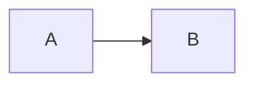

# setup/mermaid.ts and setup/mermaid-renderer.ts

Returns Mermaid's config (`theme`, `themeVariables`, `flowchart`, ...). It applies to every diagram; a diagram's own options come after it. Configs of all roots are put over each other.

<!-- verify-file: setup/mermaid.ts -->

```ts
export default () => ({ theme: 'base', themeVariables: { primaryColor: '#ff0000' } });
```

<!-- verify -->

````md
---
title: Mermaid setup
---

# Red diagram


````

`setup/mermaid-renderer.ts` returns a function `(code, options) => svg` (a string or a promise of one) that draws every diagram instead of Mermaid. `options` are the theme, the `setup/mermaid.ts` config and the fence's options, merged. `scale` still applies and the export waits for the drawing. The setup may be async and may return nothing to keep Mermaid; the last root that returns a function wins. A setup that throws is skipped with a warning; a renderer that throws or resolves to a non-string shows the error box. Install any library it uses in the deck.

<!-- verify-file: setup/mermaid-renderer.ts -->

```ts
let counter = 0;

export default () => async (code: string, options: Record<string, unknown>) => {
  const { default: mermaid } = await import('mermaid');
  mermaid.initialize({ startOnLoad: false, ...options, look: 'handDrawn' });
  return (await mermaid.render(`hand-drawn-${++counter}`, code)).svg;
};
```
