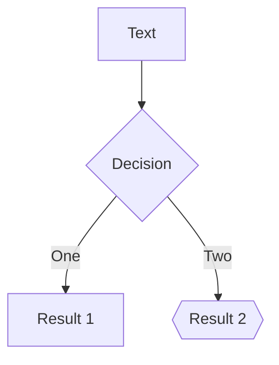
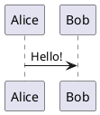

# Phase 2 showcase

Code and content

---

# Plain code

```ts
const o = { a: 1 }; // {{ not }} bound, @if too
function add(a: number, b: number) {
  return a + b;
}
```

Inline `{{ x }}` stays text.

---

# Line numbers, start line, max height

```ts {*}{lines:true,startLine:5}
function add(a: number, b: number) {
  return a + b;
}
const c = add(1, 2);
```

```ts {2}{maxHeight:'60px'}
const a = 1;
const b = 2;
const c = 3;
const d = 4;
const e = 5;
const f = 6;
```

---

# Static and stepped highlights

```ts {2,3}
const a = 1;
const b = 2;
const c = 3;
const d = 4;
```

```ts {1|2-3|4|all}
const a = 1;
const b = 2;
const c = 3;
const d = 4;
```

<div slide-ng-click id="after-code">after the code</div>

---

# Snippets

<<< ./snippets/snippet.ts#greet ts {1|2}

<<< @/snippets/snippet.ts {*}{lines:true}

---

# Code group

::code-group

```sh [npm]
npm i @slide-ng/core
```

```sh [yarn]
yarn add @slide-ng/core
```

::

---

# Magic move

````md magic-move
```js {*|1|2-3}
let count = 1
function add() {
  count++
}
```

```ts {*}{lines:true}
let count: number = 1
const add = () => count += 1
console.log(add())
```
````

<div slide-ng-click id="after-magic">after magic</div>

---

# Math

Inline $\sqrt{3x-1}+(1+x)^2$ and a price of $5 and $10 stay text, `$HOME` too.

$$
\begin{aligned}
a &= {{b}} \\
c &= d
\end{aligned}
$$

$$ {1|2|all}
\begin{aligned}
\nabla \cdot \vec{E} &= \frac{\rho}{\varepsilon_0} \\
\nabla \cdot \vec{B} &= 0 \\
\nabla \times \vec{E} &= -\frac{\partial\vec{B}}{\partial t}
\end{aligned}
$$

---

# Diagrams



<slide-ng-mermaid id="direct" code="pie title Pets&#10;&quot;Dogs&quot; : 3&#10;&quot;Cats&quot; : 2" />



---

# Monaco

```ts {monaco}
const message: string = 'edit me'
console.log(message)
```

```ts {monaco-diff}
console.log('Original text')
~~~
console.log('Modified text')
```

---

# Monaco run

```ts {monaco-run}
function distance(x: number, y: number) {
  return Math.sqrt(x ** 2 + y ** 2)
}
console.log(distance(3, 4), [1, 2], { a: 1 }, new Map([[1, 2]]))
```

```ts {monaco-run} {autorun:false,showOutputAt:'+1'}
console.log('shown after one click')
throw new Error('boom')
```

```js {monaco-run}
try { console.log(parent.document.title) } catch (e) { console.log(e.name) }
console.log(typeof localStorage === 'undefined' ? 'no storage' : (() => { try { localStorage.length; return 'has storage' } catch (e) { return e.name } })())
```

---

# Twoslash

```ts twoslash
const count = Math.max(1, 2)
//    ^?
interface Point { x: number }
const p: Point = { x: 1 }
p.x
//^?
```

```ts {1}
const plain = 'no twoslash here'
```

---

# Components

<slide-ng-arrow id="a1" x1="100" y1="300" x2="300" y2="400" color="green" width="3" />
<slide-ng-arrow id="a2" x1="400" y1="300" x2="500" y2="300" two-way />

<slide-ng-transform id="t1" scale="0.5" origin="top left">

<div id="t1-inner" class="w-40 h-10 bg-gray-200">scaled</div>

</slide-ng-transform>

<slide-ng-auto-fit-text id="fit" class="w-60 h-20 bg-gray-100" min="10" max="60">Some text that should fit its box</slide-ng-auto-fit-text>

<slide-ng-youtube id="luoMHjh-XcQ" width="320" height="180" />

---

# Video and embeds

<slide-ng-video id="vid" slide-ng-click autoplay="true" autoreset="click" controls>
  <source src="/missing.webm" type="video/webm" />
</slide-ng-video>

<slide-ng-video id="vid-once" slide-ng-click autoplay="once"></slide-ng-video>

<slide-ng-tweet id="20" scale="0.5" />

<slide-ng-blue-sky uri="at://did:plc:432mbsu2xucyvxl6sluohidu/app.bsky.feed.post/3lgwg2vy44s2q" />

---

# Marks and motion

<span id="m1" slide-ng-mark.red.circle="1">circled</span>
<span id="m2" slide-ng-mark="{ at: 2, type: 'box', color: '#00f' }">boxed</span>
<span id="m3" slide-ng-mark.underline>always underlined after the next click</span>
<span id="m4" [slide-ng-mark]="[3, 4]">only at click 3</span>
<span id="m5" slide-ng-mark.highlight.op50="true">always</span>

<div id="mo" class="w-20 h-10 bg-blue-300" slide-ng-motion :initial="{ x: -80, opacity: 0 }" :enter="{ x: 0, opacity: 1 }" :click-4="{ y: 40 }" :leave="{ x: 80 }">motion</div>

<div id="mo2" class="w-20 h-10 bg-green-300" [slide-ng-click]="[5, 6]" slide-ng-motion :initial="{ x: -50 }" :enter="{ x: 0 }" :leave="{ x: 50 }">with slide-ng-click</div>

<div id="mo3" slide-ng-click.up="[5, 6]">a range written as text, with a preset</div>

---

# Markdown extras

> [!NOTE]
> A note with `code` and **bold**.

> [!WARNING]
> Careful here.

- [x] done task
- [ ] open task

A claim[^1] and another[^second].

[^1]: The first footnote.
[^second]: The second one, with `{{ x }}` in it.

<carbon-apps id="i1" /> <mdi-account-circle id="i2" class="text-red-500" /> <ph-star-fill id="i3" />
