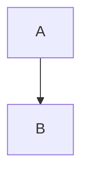

# Cover

First slide

<!-- note one -->

---

# Clicks

<div id="c1" slide-ng-click>one</div>
<div id="c2" slide-ng-click>two</div>

<slide-ng-render-when context="print"><p id="only-print">printing</p></slide-ng-render-when>
<slide-ng-render-when context="slide"><p id="only-slide">on screen</p></slide-ng-render-when>

<!-- note two [click] with a click -->

---
level: 2
---

# A flowchart



---

# Moving code

````md magic-move
```ts
const a = 1
```
```ts
const a = 2
```
````

---
clicksStart: 1
---

# Starts at one

<div id="s2" slide-ng-click="2">after two</div>

---

# Editor

```ts {monaco}
const answer = 42
```

---

# Marks

<span id="mk" slide-ng-mark.red.circle="1">circled</span>

---

# The end

Done. [Back to the clicks](2), or [a web page](https://example.org).
