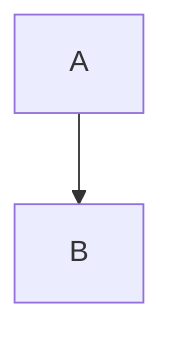

# Math, code and text

Inline math with a macro: $\RR$

Text from a transformer: [[[from pre]]]

PREPARSED

```ts
const a: number = 1
```

```rust
fn main() {}
```

```myblock
hello setup
```

---

# A diagram



```mermaid
custom drawn by the renderer
```

---

# Editors

```ts {monaco}
const x = 1
```

```python {monaco-run}
print(1 + 1)
```

---

# Theme config

<p id="tc-text" class="text-primary">Coloured by themeConfig.primary</p>
<p id="tc-label">{{ themeConfig['label'] }}</p>
<p id="tc-sizes">{{ themeConfig['sizes'] }}</p>

---
transition: my-fade
---

# Before a custom transition

---
transition:
  name: grow
  enterFromClass: grow-start
  enterActiveClass: grow-run
---

# After a custom transition

---

# After the object form

---
routeAlias: hooks
---

# Slide hooks

<hook-counter />

---
layout: center
routeAlias: globals
---

# Global context

<p id="globals">page {{ $page() }} of {{ $nav.total }}, {{ $slidev.configs.title }}, {{ $frontmatter.layout }}, shown {{ $nav.currentPage() }} {{ $nav.currentLayout() }}, {{ $renderContext() }}</p>

<div slide-ng-click>step</div>

@if ($clicks() > 0) {
<p id="after-click">clicked {{ $clicks() }}</p>
}

<button id="globals-first" (click)="$nav.go(1)">first</button>
