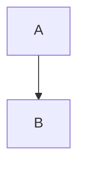

# Math, code and text

Inline math with a macro: $\RR$

Text from a transformer: [[[from pre]]]

PREPARSED

```ts
const a: number = 1
```

```rust
fn main() {}
```

```myblock
hello setup
```

---

# A diagram



---

# Editors

```ts {monaco}
const x = 1
```

```python {monaco-run}
print(1 + 1)
```

---
routeAlias: hooks
---

# Slide hooks

<hook-counter />
