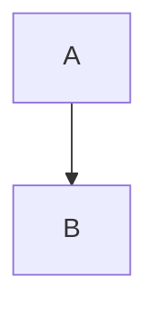

# Math, code and text

Inline math with a macro: $\RR$

Text from a transformer: [[[from pre]]]

PREPARSED

```ts
const a: number = 1
```

```rust
fn main() {}
```

```myblock
hello setup
```

---

# A diagram



---

# Editors

```ts {monaco}
const x = 1
```

```python {monaco-run}
print(1 + 1)
```

---

# Theme config

<p id="tc-text" class="text-primary">Coloured by themeConfig.primary</p>
<p id="tc-label">{{ themeConfig['label'] }}</p>
<p id="tc-sizes">{{ themeConfig['sizes'] }}</p>

---
transition: my-fade
---

# Before a custom transition

---
transition:
  name: grow
  enterFromClass: grow-start
  enterActiveClass: grow-run
---

# After a custom transition

---

# After the object form
